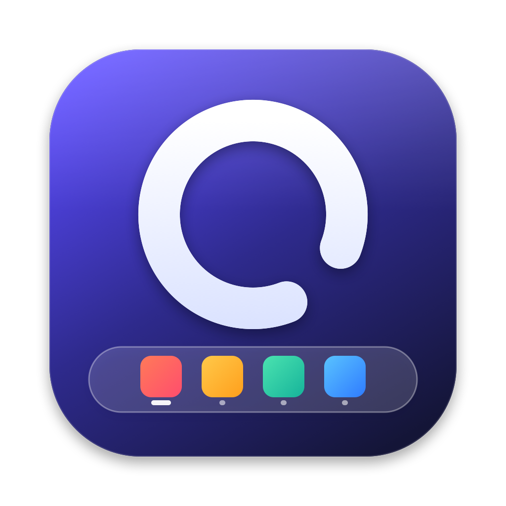
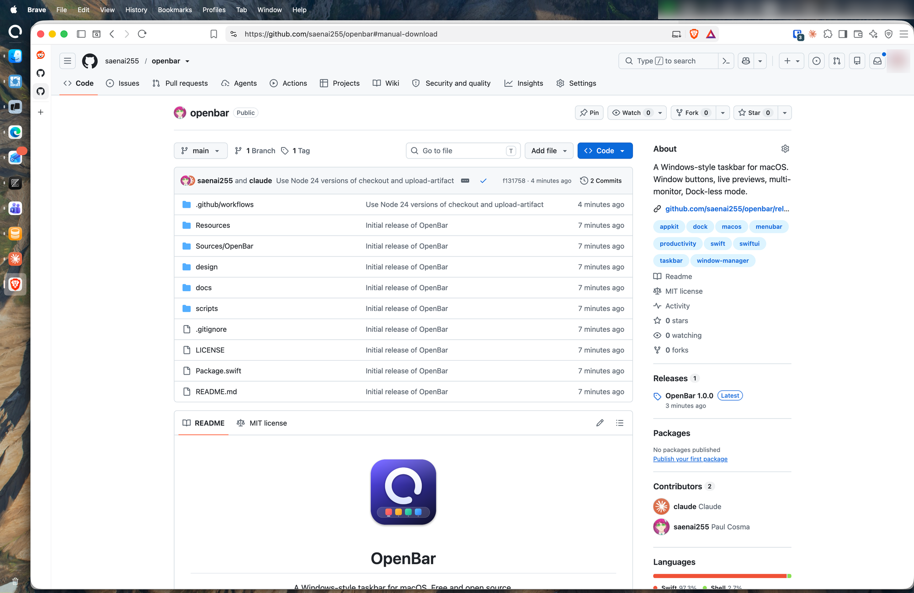

<p align="center">
  
</p>

<h1 align="center">OpenBar</h1>

<p align="center">
  A Windows-style taskbar for macOS. Free and open source.
</p>

<p align="center">
  <a href="https://github.com/saenai255/openbar/releases/latest">Download</a> ·
  <a href="#install">Install</a> ·
  <a href="#features">Features</a> ·
  <a href="#troubleshooting">Troubleshooting</a>
</p>

---

<p align="center">
  
</p>

OpenBar puts a taskbar along the edge of your screen. Every open window gets a button, so you can see what's running and jump to it in one click. It can sit next to the Dock or replace it entirely.

> [!NOTE]
> OpenBar is vibecoded: it was built largely with an AI coding assistant, so expect bugs and rough edges. [Issues](https://github.com/saenai255/openbar/issues) and [pull requests](https://github.com/saenai255/openbar/pulls) are very welcome.

## Install

### Homebrew

```bash
brew install --cask saenai255/tap/openbar
```

Update later with `brew upgrade --cask openbar`.

### Manual download

1. Download the latest `OpenBar-x.y.z.dmg` from [Releases](https://github.com/saenai255/openbar/releases/latest).
2. Open it and drag **OpenBar** into **Applications**.
3. OpenBar isn't notarized by Apple, so macOS blocks it the first time. Clear the block with:

   ```bash
   xattr -dr com.apple.quarantine /Applications/OpenBar.app
   ```

   Or open **System Settings → Privacy & Security**, scroll down and click **Open Anyway**.

Requires macOS 26 (Tahoe) or later, on Apple silicon or Intel.

## First launch

OpenBar asks for a few permissions. Only the first one is required.

| Permission | Why | Where |
| --- | --- | --- |
| **Accessibility** | List, focus, minimize, close and arrange windows | System Settings → Privacy & Security → Accessibility |
| Screen Recording | Window thumbnails when you hover a button | System Settings → Privacy & Security → Screen & System Audio Recording |
| Full Disk Access | Shows whether the Trash is empty | System Settings → Privacy & Security → Full Disk Access |

You can check and grant them any time under **OpenBar Settings → Permissions**. After granting Screen Recording, use **Relaunch OpenBar** on that tab.

## Features

**Taskbar**
- Sits on the bottom, top, left or right edge, in three sizes.
- Can auto-hide, and gets out of the way of full-screen apps.
- A bar on every display, each showing only the windows on that display.
- Keeps windows from sliding under the bar, so maximized windows stop at its edge.

**Apps and windows**
- Pinned favorites (apps or folders) first, then running apps.
- One button per app, or one per window, with window titles.
- Click an app to bring it forward. Click it again to cycle through its windows.
- Hover for live window previews; click a preview to jump to that window.
- Middle-click to close a window or open a new one.
- Right-click for the window list, hide, quit, force quit, pin and exclude.
- Notification badges, a flash when an app wants your attention, a pulse while an app launches, and a striped "Not Responding" look for frozen apps, with **Force Relaunch**.

**Drag and drop**
- Drag buttons along the bar to reorder your favorites, or to arrange running apps in your own order.
- Drop an app or folder from Finder onto the bar to pin it.
- Drop a document onto an app to open it with that app.

**Menu and tray**
- The OpenBar menu: Sleep, Restart, Shut Down, Lock Screen, Log Out, Force Quit, an Applications menu and System Settings.
- Clock with a calendar, volume (scroll over it to change, right-click to mute), battery, Trash, and a Show Desktop strip at the far end.

**Appearance**
- Glass, Light, Dark or a custom theme, with your own background, text, highlight and badge colors.

## Using OpenBar instead of the Dock

Turn on **Dock-less mode** in **Settings → General** to push the Dock out of the way. Turning it off restores your previous Dock settings.

If you keep the Dock, put it on a different edge from OpenBar, or set it to auto-hide.

## Settings

Open **Settings** from the OpenBar menu, the first button on the bar. You can also launch OpenBar again from Applications while it's running.

- **General**: position, size, auto-hide, multiple displays, window behaviour, Dock-less mode, open at login.
- **Appearance**: theme and colors, window titles.
- **Apps**: app order, favorites, excluded apps, current-Space filtering.
- **Areas**: show or hide the menu, clock, battery, sound, Trash and Show Desktop.
- **Permissions**: status of each permission, with shortcuts to grant them.

## Troubleshooting

**The bar shows apps but clicking does nothing, or windows are missing.**
Accessibility permission is missing or stale. In **System Settings → Privacy & Security → Accessibility**, select OpenBar, click **–**, then add it again with **+**.

**"OpenBar can't be opened because Apple cannot check it for malicious software."**
See step 3 of [Manual download](#manual-download). Homebrew installs handle this automatically.

**Window previews show titles but no pictures.**
Grant Screen Recording, then click **Relaunch OpenBar** in **Settings → Permissions**.

**The Dock covers the bar.**
Move the Dock to another edge, set it to auto-hide, or turn on **Dock-less mode**.

## Uninstall

```bash
brew uninstall --cask openbar       # if installed with Homebrew
```

Otherwise, quit OpenBar from its menu and move it from Applications to the Trash. If you used Dock-less mode, turn it off before uninstalling so your Dock settings are restored.

## Building from source

See [docs/DEVELOPMENT.md](docs/DEVELOPMENT.md).

## License

[MIT](LICENSE). OpenBar is inspired by uBar but is an independent project, not affiliated with Brawer Software.
